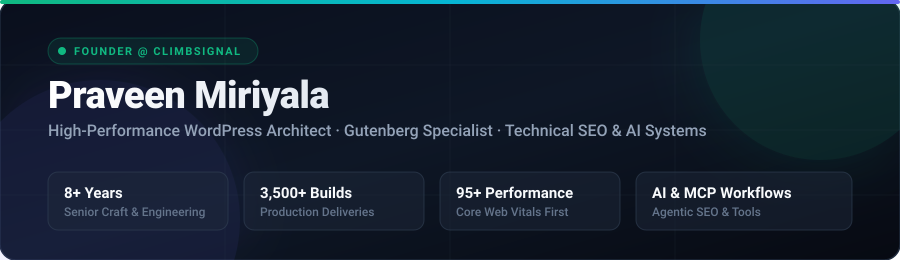

<div align="center">
  <a href="https://climbsignal.in">
    
  </a>

  <br/><br/>

  <p align="center">
    <a href="https://climbsignal.in"></a>
    <a href="https://github.com/climbsignal"></a>
    <a href="https://www.linkedin.com/company/climbsignal"></a>
    <a href="https://x.com/ClimbSignal"></a>
    <a href="https://climbsignal.in/?fluent-booking=calendar&host=climbsignal&event=website-discovery-call"></a>
  </p>
</div>

---

### 👨‍💻 About Me

I’m **Praveen Miriyala**, Founder & Principal Architect at [**ClimbSignal**](https://climbsignal.in).

Over the past **8+ years** and across **3,500+ production website builds**, I have specialized in closing the gap between high-end design, clean WordPress architecture, sub-second performance, and technical SEO. I combine deep production craftsmanship with modern AI-assisted workflows—building lightning-fast digital experiences without the bloat of traditional page builders or layers of agency account management.

- 📍 **Based in:** Visakhapatnam, Andhra Pradesh, India
- 🏢 **Studio:** Founder @ [ClimbSignal](https://climbsignal.in) ([GitHub Profile](https://github.com/climbsignal))
- ⚡ **Core Focus:** Native Gutenberg Block Architecture, Core Web Vitals (95+), Technical SEO & Crawl Graphs, and Model Context Protocol (MCP) AI Systems
- 💬 **Ask me about:** WordPress Full-Site Editing, headless/hybrid WooCommerce, programmatic SEO, and building agentic workflows for search engines

---

### ⚡ Core Engineering Pillars

| Area | Engineering Focus & Standards |
| :--- | :--- |
| **🚀 High-Performance WordPress** | Block-first Gutenberg development, custom block pattern libraries, zero page-builder bloat, sub-second TTFB, and consistent 95+ Core Web Vitals. |
| **🔍 Technical & Semantic SEO** | Search-ready crawl controls, entity graphs, automated Schema.org (JSON-LD) structured data, 301 migration maps, and AI search visibility. |
| **🤖 AI Workflows & MCP Systems** | Model Context Protocol (MCP) servers, custom AI coding agents, automated SEO spiders, and rapid prototyping workflows. |
| **🛒 WooCommerce & E-Commerce** | Clean product taxonomies, optimized checkout funnels, scalable database queries, and custom payment/shipping integrations. |

---

### 🛠️ Tech Stack & Toolkit

```
Languages & Core:       PHP · JavaScript (ESNext) · TypeScript · Python · HTML5 · CSS3 / SASS / PostCSS
CMS & Frameworks:       WordPress · Gutenberg (Block API & FSE) · WooCommerce · React · Next.js · Tailwind CSS
SEO & Diagnostics:      Technical SEO · Schema.org (JSON-LD) · Screaming Frog · Lighthouse / CWV · Google Search Console
AI & Protocols:         Model Context Protocol (MCP) · FastMCP · Claude API · OpenAI / Gemini API · AI Agent Tools
Infrastructure & Tools: Cloudflare CDN/DNS · LiteSpeed · WP-CLI · Git & GitHub Actions · Vite · Figma
```

<div align="center">
  
  
  
  
  
  
  
  
  
  
  
  
</div>

---

### 🌟 Featured Projects & Initiatives

- 🏢 [**ClimbSignal**](https://climbsignal.in/) — High-performance WordPress, Gutenberg & technical SEO engineering studio in India. Built for sub-second page loads and search-ready lead generation without agency bloat.
- 🕷️ [**OpenSpider-AI**](https://github.com/PraveenMiriyala/OpenSpider-AI) — The open-source, unlimited technical SEO spider & native FastMCP server engineered specifically for AI coding agents.
- 📦 [**Full-Stack-Template**](https://github.com/PraveenMiriyala/Full-Stack-Template) — Production-ready modern full-stack application foundation with comprehensive developer ergonomics.

---

### 📊 GitHub Activity & Statistics

<div align="center">
  
  
</div>

<div align="center">
  
</div>

---

### 📬 Connect With Me & ClimbSignal

- 🌐 **Company Website:** [climbsignal.in](https://climbsignal.in/)
- 📅 **Book a Discovery Call:** [Schedule via Calendar](https://climbsignal.in/?fluent-booking=calendar&host=climbsignal&event=website-discovery-call)
- 📊 **Free Technical Audit:** [climbsignal.in/free-website-review](https://climbsignal.in/free-website-review/)
- 💼 **LinkedIn:** [Praveen Miriyala / ClimbSignal](https://www.linkedin.com/company/climbsignal/)
- 🆇 **X / Twitter:** [@ClimbSignal](https://x.com/ClimbSignal)
- 📧 **Direct Inquiries:** `hello@climbsignal.in` / `climbsignal@gmail.com`
- 🏢 **HQ:** Visakhapatnam, Andhra Pradesh, India (MSME: `UDYAM-AP-10-0152913`)

<div align="center">
  <sub>Crafted with intention · Powered by clean code &amp; modern AI systems</sub>
</div>
